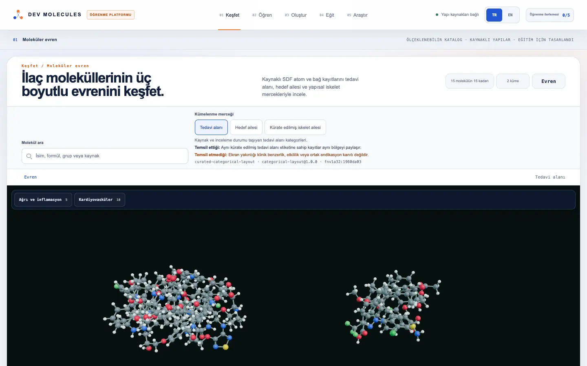
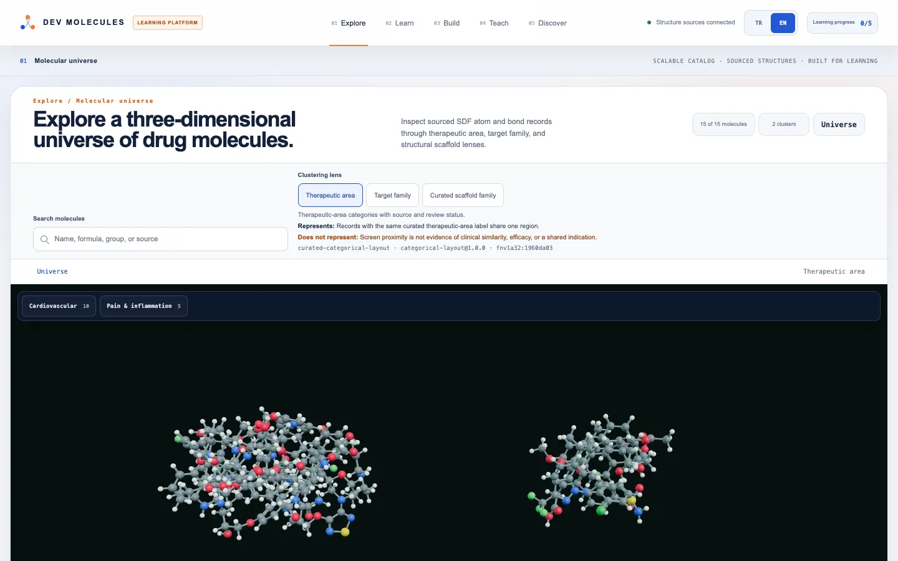
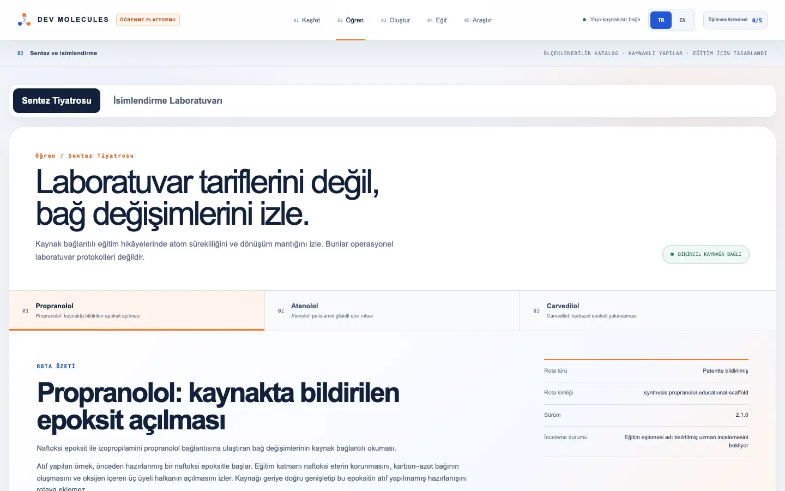
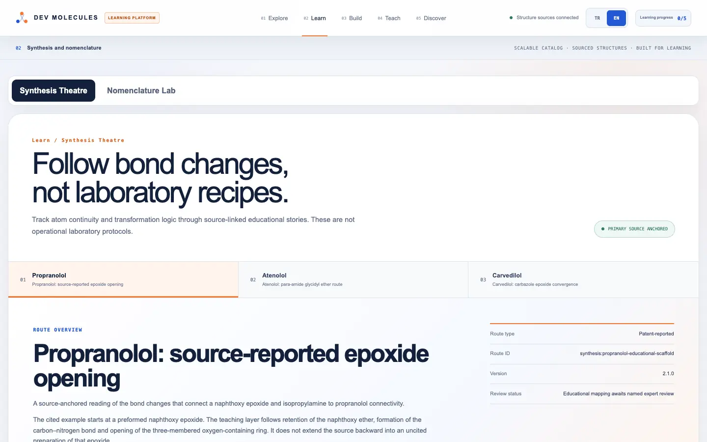
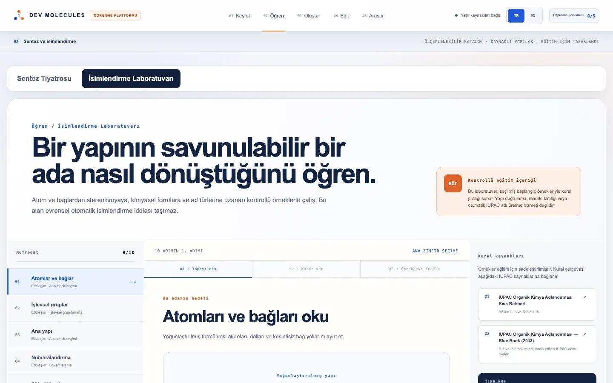
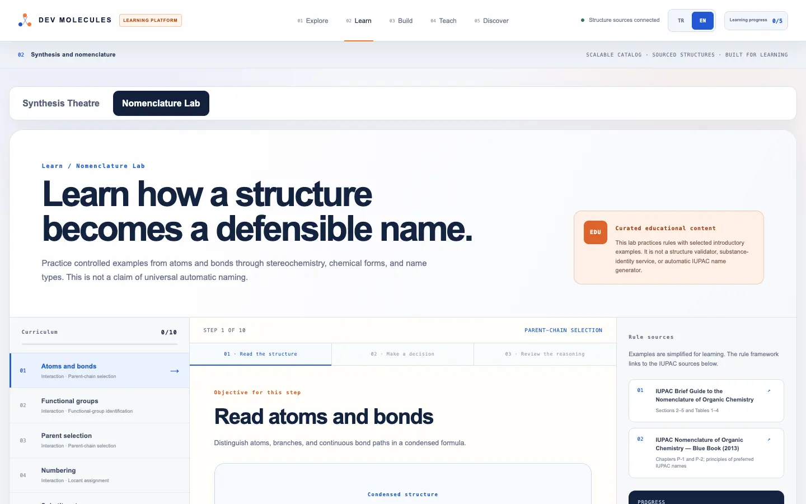

# Dev Molecules

Dev Molecules is a bilingual, evidence-aware molecular learning environment for exploring drug structures, reading non-operational synthesis narratives, practising nomenclature, and keeping educational conclusions separate from scientific verification.

[Live application](https://pharmacist65.github.io/dev-molecules/) · [Public source repository](https://github.com/Pharmacist65/dev-molecules)

**Release status:** Public Vertical Slice v0.1 — a reviewable engineering and educational MVP, not a completed university platform or scientifically peer-reviewed publication.

## Product snapshots

All screenshots below come from the same static GitHub Pages build exercised by the browser acceptance suite.

### Explore — sourced molecular universe

| Turkish | English |
| --- | --- |
|  |  |

### Learn — Synthesis Theatre

| Turkish | English |
| --- | --- |
|  |  |

### Learn — Nomenclature Lab

| Turkish | English |
| --- | --- |
|  |  |

## What is implemented

The product shell keeps five modes available in one desktop-first experience:

- **Explore** — Universe → cluster → molecule focus navigation over 15 seed records. It uses checked-in PubChem 2D/3D SDF assets, a shared Three.js scene, progressive level of detail, explicit structure provenance, and exact Drugs@FDA product/form anchors.
- **Learn** — two distinct workspaces: **Synthesis Theatre** and **Nomenclature Lab**. The theatre contains three direct-patent-anchored, non-operational stories for propranolol, atenolol, and carvedilol, plus six source-aware challenge types. The lab contains ten addressable topics, ten curated exercises, and six deterministic interaction types.
- **Build** — a guided educational fragment-building exercise. Completion is a learning result, not evidence that a laboratory synthesis is possible.
- **Teach** — device-local progress and review-queue views. Learning progress is kept separate from scientific review status.
- **Discover** — an explicitly experimental, private-by-default evidence workspace. Missing evidence fails closed and never becomes novelty, efficacy, patentability, or synthesizability.

Turkish and English are complete product locales. The language preference is stored in the browser, the document language is updated at runtime, and changing language does not change molecular IDs, evidence states, or Explore topology. See [Localization](docs/LOCALIZATION.md).

The seed count is test data, not a catalog or schema ceiling.

## Scientific boundary

Dev Molecules is educational software, not clinical, laboratory, regulatory, or patent advice.

- A source link does not by itself make an interpretation expert-reviewed or verified.
- `source-supported`, `pending-review`, `predicted`, `conflicting`, and `unknown` remain distinct states.
- The three synthesis stories expose transformation logic and direct source locators, but omit quantities, apparatus, conditions, duration, work-up, yield, and other operational laboratory parameters.
- Draft atom correspondence and educational classifications remain visibly review-gated.
- A missing structure or source produces an explicit unavailable state; the application does not invent atoms, bonds, routes, or claims.
- The current slice does not persist designs or research questions. Any deployment that enables optional external narration must disclose that processing boundary and obtain the required consent before sending a question to the provider.

Read [Scientific governance](docs/SCIENTIFIC_GOVERNANCE.md) and [Synthesis provenance](docs/SYNTHESIS_PROVENANCE.md) before changing scientific content.

## Run locally

Requirement: Node.js `>=22.23.2` (the Node test suite uses built-in TypeScript type stripping; CI validates the patched 22.x LTS release).

```bash
npm ci
npm run dev
```

Open `http://localhost:3000/`. Stable Explore hashes include:

```text
http://localhost:3000/#universe
http://localhost:3000/#molecule/propranolol
http://localhost:3000/#cluster/therapeutic/Cardiovascular
```

## Quality gates

Run the same core gates used by CI:

```bash
npm run typecheck
npm run lint
npm run build
npm run build:pages
node --test tests/*.test.mjs
npx playwright test
npm run e2e:pages
npm audit --audit-level=high
npm audit --omit=dev --audit-level=high
git diff --check
```

The GitHub Actions workflow runs the production-dependency audit, type checking, linting, both production builds, Node test suites, and Playwright browser acceptance tests on pushes to `main` and pull requests. A push is published to GitHub Pages only after the server-capable and static-browser gates pass. Tests cover structure parsing and provenance, product/form identity boundaries, deterministic lens projection, bounded level-of-detail policy, the shared scene adapter, TR/EN parity, synthesis provenance and challenge scoring, nomenclature scoring, fail-closed evidence behavior, real-browser interaction, and the `/dev-molecules/` project base path.

## Architecture and project policy

- [Architecture](docs/ARCHITECTURE.md)
- [Roadmap and acceptance gates](docs/ROADMAP.md)
- [Scientific governance](docs/SCIENTIFIC_GOVERNANCE.md)
- [Localization](docs/LOCALIZATION.md)
- [Synthesis provenance](docs/SYNTHESIS_PROVENANCE.md)
- [Security policy](SECURITY.md)
- [Contributing](CONTRIBUTING.md)
- [CI workflow](.github/workflows/quality.yml)
- [Deployment](docs/DEPLOYMENT.md)
- [Changelog](CHANGELOG.md)
- [Third-party notices](THIRD_PARTY_NOTICES.md)

Key boundaries:

```text
app/                              application entry points and evidence endpoint
components/universe/              Explore navigation and level-of-detail orchestration
components/molecular-scene/       shared Three.js scene port and adapter
components/platform/              five-mode learning and evidence surfaces
lib/domain/                       typed chemistry, evidence, learning, and scoring rules
lib/application/                  deterministic view-model composition
lib/data/                         seed catalogs, source registries, and curricula
lib/i18n/                         typed TR/EN runtime and localized content overlays
lib/structure/                    V2000 parsing and element presentation rules
public/structures/pubchem/        checked-in source SDF assets
tests/                            domain, data, renderer, SSR, and API checks
e2e/                              Playwright production-bundle acceptance tests
e2e-pages/                        GitHub Pages base-path and static-runtime acceptance
deployment/github-pages/          static entry document; product UI remains shared
```

The public application is a static GitHub Pages build. It imports the same product shell and checked-in scientific records as the server-capable Sites/Cloudflare build; it does not fork product behavior. Because GitHub Pages has no server runtime, Discover uses the same curated, fail-closed local evidence-card path and never receives an API secret. No persistent database or object store is configured in the current repository slice.

This repository is publicly reviewable but is **not currently offered under an open-source project license**. Repository visibility must not be interpreted as a license grant. Checked-in PubChem SDF redistribution remains explicitly subject to the source-rights review recorded in the roadmap and scientific governance documents. Review [Deployment](docs/DEPLOYMENT.md) and [Third-party notices](THIRD_PARTY_NOTICES.md) before redistribution.

## Türkçe kısa özet

Dev Molecules; ilaç yapılarını kaynak ve inceleme durumlarıyla keşfetmeyi, operasyonel laboratuvar tarifi vermeden sentez mantığını okumayı ve IUPAC adlandırma alıştırmaları yapmayı sağlayan TR/EN bir öğrenme ortamıdır. Explore, Learn, Build, Teach ve Discover modları aynı ürün kabuğunda çalışır. Mevcut 15 molekül, üç sentez hikâyesi ve on adlandırma konusu yalnızca başlangıç içeriğidir; bilimsel doğruluk, kaynak çözümleme ve gizlilik kuralları katalog büyüdükçe de korunmalıdır.
